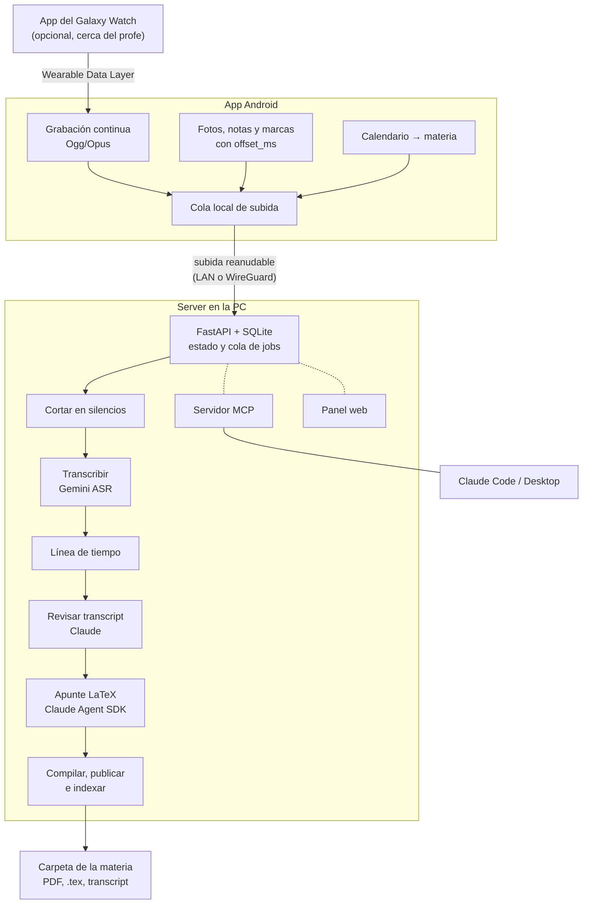
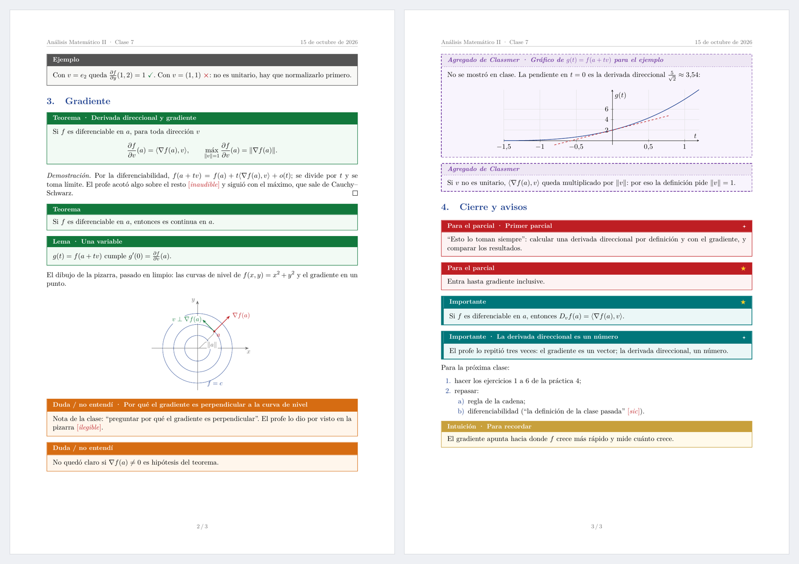
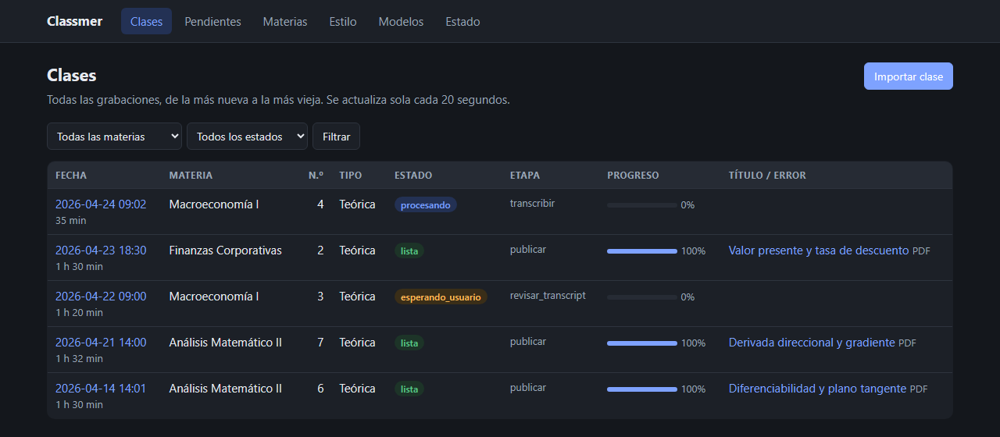

# Classmer

**Convierte cada clase grabada de la facultad en un apunte completo en LaTeX, listo para estudiar.**

*[Read in English](README.md)*

Grabás la clase con el celular (o con un reloj cerca del profe), sacás fotos de la pizarra y marcás
los momentos importantes. Cuando termina, un server en tu PC transcribe el audio, limpia el
transcript, y un agente de Claude escribe el apunte en LaTeX, compila el PDF y lo deja en la carpeta
de la materia. Después estudiás con Claude sobre todas tus clases a través de un servidor MCP, y
cada respuesta cita la clase y el minuto.

Es un sistema personal, de un solo usuario, que uso para mis propias clases.

## El problema

Prestar atención y tomar buenos apuntes a la vez no funciona: o seguís la explicación o la
escribís. Yo ya grababa las clases y las pasaba a apuntes a mano, con la grabadora, la cámara y un
chat con un LLM. Classmer automatiza todo ese circuito con tres reglas:

- **No perder nunca una clase.** La grabación es local-first y la subida aguanta cortes de red,
  caídas de la app y reinicios del server.
- **Ser fiel a la clase.** El apunte sigue lo que se dijo. Lo que agrega el modelo va marcado como
  agregado, y lo que no se entiende se marca en vez de inventarse.
- **El tiempo es el eje.** Las fotos, las notas, las marcas y las secciones del apunte llevan el
  milisegundo de la grabación al que pertenecen: todo se puede rastrear hasta el audio.

## Cómo funciona



Cada etapa del pipeline es un job en SQLite que escribe su salida en la carpeta de la clase y se
puede volver a correr sola: `verificar → segmentar → transcribir → linea_de_tiempo → clasificar →
revisar_transcript → apunte → publicar`.

## Qué sale



*Dos páginas del apunte compilado de [`ejemplo.tex`](server/templates/latex/ejemplo.tex), el apunte
de referencia que viene con la plantilla (contenido ficticio): definiciones y teoremas, un dibujo de
la pizarra pasado a TikZ, dudas, avisos de parcial marcados con ⭐ en clase o con ✦ si los detectó
Classmer, y lo que agrega Classmer en cajas punteadas.*



*El panel web de una instancia de prueba con clases inventadas.*

## Lo técnico

**Grabación local-first con subida reanudable.** La app escribe un solo archivo Ogg/Opus por clase,
continuo y que sólo crece (mono, 48 kHz, 32 kbps, unos 19 MB por hora). Si la app se cae, el archivo
sirve hasta la última página completa. La subida agrega bytes desde un offset
(`PUT /audio?offset=N`); si no coincide, el server responde `409` con lo que tiene y el celu sigue
desde ahí. Los eventos y las fotos son idempotentes por un UUID que genera el celu, `/finalizar`
compara el SHA-256 del archivo entero y el celu no borra nada hasta que el server confirmó todo.

**El reloj y el celu a la vez, alineados por correlación.** Un Galaxy Watch en la muñeca del profe
capta la voz 42 dB por encima del ruido (26 dB con el celu en el banco) y saca un 13 % más de
palabras transcriptas. El reloj graba la pista principal y se la pasa al celu por el Wearable Data
Layer, en tramas con offset y CRC32, y retoma después de un corte de Bluetooth. El celu graba una
segunda pista al mismo tiempo. El desfase entre las dos sale de idas y vueltas de ping entre los
relojes (±23 ms, medido en un Galaxy Watch 8) y, si esa medición falta, el server lo recupera
correlacionando la envolvente de energía de las dos grabaciones (ffmpeg y una FFT en Python).

**Transcripción con Gemini, con validación.** El server corta el audio en silencios, en bloques de
unos 10 minutos, y los transcribe en paralelo con el ASR de Gemini (tiempos por palabra y quién
habla). Cada bloque se valida: que no venga vacío, que no tenga huecos donde el detector de voz oyó
habla y que no repita texto en loop. Los límites de cuota y las caídas posponen el job sin gastar
intentos, y un bloque que igual falla queda marcado como inaudible en vez de tirar la clase.

**Revisión del transcript con Claude, automática o asistida.** Antes del apunte, Claude (con salida
estructurada) concilia los dos transcripts línea por línea y los limpia: muletillas, puntuación,
quién habla, términos y notación. Hay una regla dura: se corrige lo que el ASR entendió mal, nunca lo
que dijo el profe. Si las dos versiones difieren en algo que cambia el sentido, Gemini vuelve a
escuchar esos segundos en las dos grabaciones. Las dudas que quedan toman la propuesta del modelo
(modo automático) o me esperan en el panel web, con los dos audios a un clic (modo asistido). En una
clase real de 92 minutos, la distancia a un transcript corregido a mano bajó de 8,1 % a 5,5 %, con un
costo de entre US$ 0,65 y 1,8 por clase.

**Apuntes en LaTeX con el Claude Agent SDK.** El agente trabaja en una carpeta de trabajo
(`input/`, `plantilla/`, `output/`): lee la línea de tiempo, las fotos, las slides adjuntas y el
perfil de la materia, escribe `apunte.tex` y un `meta.json` (secciones con su minuto, avisos de
parcial, tareas y fechas) que se valida contra un esquema JSON, compila con MiKTeX y corrige sus
propios errores (hasta 5 intentos o 10 minutos). La plantilla `classmer.cls` fija sólo el look;
adentro, el modelo puede usar TikZ, pgfplots o la estructura que quiera. Un filtro de rutas de LaTeX
bloquea cualquier lectura fuera de la carpeta de trabajo: es una defensa contra la inyección de
instrucciones desde el material adjunto. Republicar archiva la versión anterior, y una versión que no
compiló nunca reemplaza a una que sí.

**Una cola de jobs en SQLite.** Sin broker: el worker toma los jobs de forma atómica con
`UPDATE … RETURNING`, un lease recupera los jobs de un proceso caído, `run_after` resuelve los
reintentos con espera, las cuotas y el trabajo nocturno, y un candado de archivo asegura un solo
worker por carpeta de datos. Los archivos son el contenido y SQLite es el índice y el estado: todo lo
importante se puede abrir desde el explorador de archivos.

**Un servidor MCP para estudiar.** Corre en el mismo proceso que la API: Streamable HTTP, sin
estado, implementado desde cero sin dependencias nuevas, con el mismo token que la app. Sus 8
herramientas listan materias y clases, leen el apunte, devuelven lo que se dijo entre dos minutos,
buscan (FTS5 de SQLite, sin importar tildes) y manejan los pendientes. Cada resultado trae una cita
lista, como "Análisis Matemático II, clase 7, min 00:34:10". Un puente stdio conecta Claude Desktop y
Codex sin dejar el token escrito en su configuración.

**Además:**
- Un switch de facturación para todo lo que Classmer le pide a Claude: API key, plan Max, o uno con
  el otro de respaldo, que cambia solo si se acaban los créditos o el cupo.
- Un catálogo de modelos que se descubre con las APIs de Anthropic y de Google. Cada tarea
  (transcribir, clasificar, revisar, apunte) elige modelo y esfuerzo de una lista, global o por
  materia.
- Importar una clase que no se grabó con la app, como un audio de WhatsApp con fotos y PDFs. Las
  fotos se ubican en la línea de tiempo por su hora EXIF.
- Un panel web (sólo desde la PC) con las clases, el audio desde cualquier minuto, la revisión del
  transcript, los adjuntos, las materias, los modelos y los pendientes. La config YAML se edita en
  vivo y conserva sus comentarios.
- Una tarea programada de Windows que corre el server sin ventana, lo levanta si se cae y nunca
  arranca dos.

## Stack

| Parte | Stack |
|---|---|
| App del celu | Kotlin, Jetpack Compose, WorkManager, MediaRecorder (Ogg/Opus), OkHttp, kotlinx.serialization |
| App del reloj | Kotlin, Compose for Wear OS, Wearable Data Layer (MessageClient, ChannelClient), Ongoing Activity |
| Server | Python 3.12+ con uv, FastAPI, uvicorn, SQLite (WAL, FTS5), Jinja2, ruamel.yaml, ffmpeg, MiKTeX |
| IA | Gemini `gemini-3.5-transcribe` (ASR), Claude Sonnet 5.5 (revisión y clasificación, salida estructurada), Claude Opus 5.5 con el Claude Agent SDK (apuntes) |
| Tests | pytest (unos 1500 tests en el server), JUnit (unos 330 en la app del celu, la del reloj y el módulo común) |

## Estructura del repo

```
ARCHITECTURE.md    el diseño completo: contrato de la API, pipeline, datos, MCP, seguridad
server/            server en Python: API, pipeline, capa de IA, MCP, panel web, plantilla LaTeX, prompts
android/app/       app del celu
android/wear/      app del Galaxy Watch
android/watchlink/ lo que comparten las dos apps (mensajes del Data Layer, tramas, desfase)
android/tools/     servidor falso para probar la app sin el server
```

El código, los comentarios y la documentación están en castellano.

## Cómo correrlo

Corre en Windows 11 (la tarea programada y las rutas por defecto son de Windows). Hace falta Python
3.12+ con [uv](https://docs.astral.sh/uv/), ffmpeg, MiKTeX, una API key de Gemini y, o bien Claude
Code logueado con el plan Max, o una API key de Anthropic.

```powershell
cd server
uv sync
uv run classmer init     # crea Classmer-data con config.yaml, .env y el token del celu
# poné GEMINI_API_KEY (y, si querés, ANTHROPIC_API_KEY) en Classmer-data\.env
uv run classmer serve    # API y worker en el puerto 8000; panel en http://127.0.0.1:8000/panel
uv run pytest
```

```bash
cd android
./gradlew assembleDebug testDebugUnitTest :watchlink:test
python tools/servidor_falso.py --puerto 8765 --token classmer-dev   # probar la app sin el server
```

Más detalle: [server/README.md](server/README.md) y [android/README.md](android/README.md).

## Hecho con Claude Code

Classmer se diseñó y se programó con [Claude Code](https://claude.com/claude-code). Una sesión
coordinadora se encargó del documento de diseño ([ARCHITECTURE.md](ARCHITECTURE.md)) y dividió cada
funcionalidad en un brief escrito. Otras sesiones hicieron el server, la app de Android, la del
reloj, el servidor MCP y cada funcionalidad posterior, cada una en su rama y con sus tests, y la
coordinadora las revisó y las integró. Claude también está adentro del producto: revisa los
transcripts y escribe los apuntes.

## Licencia

[MIT](LICENSE)
