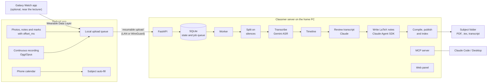
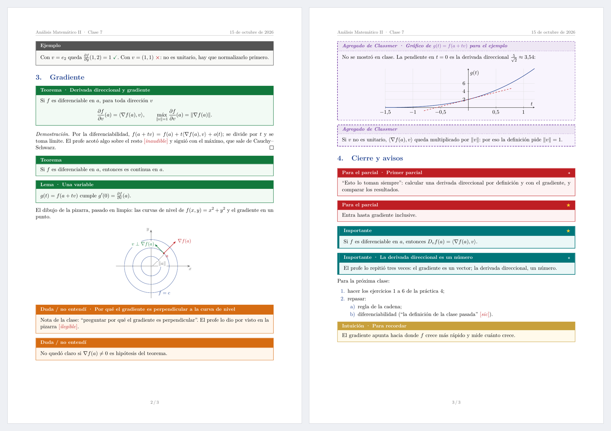
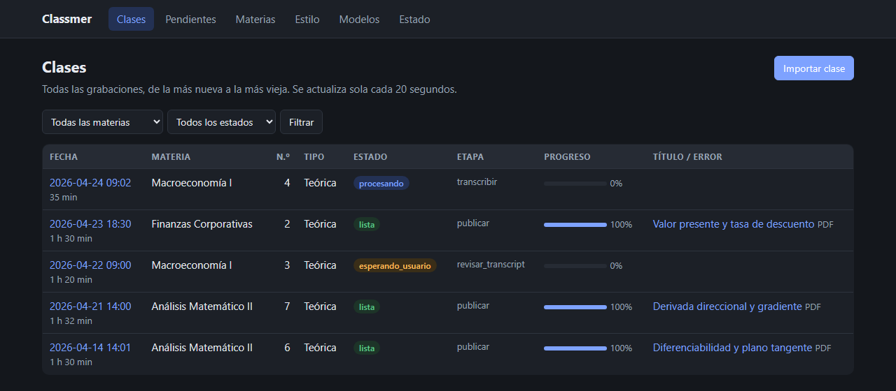

# Classmer

**Turns every recorded university lecture into complete, study-ready LaTeX notes, automatically.**

*[Leer en castellano](README.es.md)*

You record the class on your phone (or on a smartwatch placed near the lecturer), snap photos of the
whiteboard and mark the important moments. When the class ends, a server on your home PC
transcribes the audio, cleans up the transcript, and a Claude agent writes the notes in LaTeX,
compiles the PDF and drops it into the subject's folder. Later you study with Claude over all your
classes through an MCP server, with every answer citing the class and the minute.

It is a personal, single-user system that I use for my own classes.

## The problem

Paying attention and taking good notes at the same time does not work well: you either follow the
explanation or you write it down. I was already recording classes and turning them into notes by
hand, with a voice recorder, the camera and a chat with an LLM. Classmer automates that loop end to
end, with three rules:

- **Never lose a class.** Recording is local-first and the upload survives network drops, app
  crashes and server restarts.
- **Stay faithful to the class.** The notes follow what was actually said. Anything the model adds is
  marked as an addition, and anything that cannot be understood is flagged instead of made up.
- **Time is the backbone.** Photos, notes, marks and sections of the notes all carry the
  millisecond of the recording they belong to, so everything can be traced back to the audio.

## How it works



Each stage of the pipeline is a job in SQLite that writes its output to the class folder and can be
re-run on its own: `verificar → segmentar → transcribir → linea_de_tiempo → clasificar →
revisar_transcript → apunte → publicar`.

## What it produces



*Two pages of notes compiled from [`ejemplo.tex`](server/templates/latex/ejemplo.tex), the reference
note that ships with the template (fictional content): definitions and theorems, a whiteboard drawing
redone in TikZ, doubts, exam hints marked ⭐ in class or ✦ detected by Classmer, and Classmer's own
additions in dashed boxes.*



*The web panel of a demo instance with made-up classes.*

## Technical highlights

**Local-first recording with resumable upload.** The app writes one continuous, append-only
Ogg/Opus file per class (mono, 48 kHz, 32 kbps, about 19 MB per hour). If the app dies, the file is
valid up to the last complete page. Uploads append bytes at an offset (`PUT /audio?offset=N`); on a
mismatch the server answers `409` with what it has and the phone resumes from there. Events and
photos are idempotent by a UUID generated on the phone, `/finalizar` checks a SHA-256 of the whole
file, and nothing is deleted from the phone until the server has confirmed everything.

**Watch and phone at the same time, aligned by correlation.** A Galaxy Watch on the lecturer's wrist
captures the voice 42 dB above the noise (26 dB on the phone at the student's desk) and yields 13 %
more transcribed words. The watch records the main track and streams it to the phone over the
Wearable Data Layer with offsets and CRC32, resuming after Bluetooth drops. The phone records a
second track at the same time. Their offset comes from ping round-trips between both clocks
(±23 ms, measured on a Galaxy Watch 8), and when that measurement is missing, the server recovers
it by cross-correlating the energy envelopes of both recordings (ffmpeg and an FFT in Python).

**Transcription with Gemini, validated.** The server splits the audio on silences into blocks of
about 10 minutes and transcribes them in parallel with Gemini's dedicated ASR model (word timings and
diarization). Every block is validated: not empty, no gaps where the voice detector heard speech, no
looping text. Rate limits and outages postpone the job without burning retries, and a block that
still fails is marked as inaudible instead of failing the whole class.

**Transcript review with Claude, automatic or assisted.** Before the notes are written, Claude
(structured output) reconciles the two transcripts line by line and cleans them up: fillers,
punctuation, speaker labels, technical terms and notation. One rule is strict: fix what the ASR got
wrong, never what the lecturer said. When the two versions disagree in a way that changes the
meaning, Gemini listens to those seconds again in both recordings. The remaining doubts either take
the model's proposal (automatic mode) or wait for me in the web panel, with both audio clips one
click away (assisted mode). On a real 92-minute class, the distance to a hand-corrected transcript
went from 8.1 % to 5.5 %, at about US$ 0.65 to 1.8 per class.

**LaTeX notes with the Claude Agent SDK.** The agent works in a job folder (`input/`, `plantilla/`,
`output/`): it reads the timeline, the photos, the attached slides and the subject's profile,
writes `apunte.tex` plus a `meta.json` (sections with their minute, exam hints, tasks and dates)
validated against a JSON schema, compiles with MiKTeX and fixes its own errors (up to 5 attempts or
10 minutes). The `classmer.cls` template fixes only the look; inside, the model is free to use TikZ,
pgfplots or any structure. A LaTeX path filter blocks any read outside the job folder, a defense
against prompt injection through attached material. Republishing archives the previous version,
and a version that did not compile never replaces one that did.

**A job queue in SQLite.** No broker: a worker claims jobs atomically with
`UPDATE … RETURNING`, leases recover the jobs of a crashed process, `run_after` handles backoff,
quotas and overnight work, and a file lock guarantees a single worker per data folder. The files are
the content and SQLite is the index and the state, so everything important can be opened from the
file explorer.

**An MCP server for studying.** It runs in the same process as the API: Streamable HTTP, stateless,
implemented from scratch without extra dependencies, with the same token as the app. Its 8 tools list
subjects and classes, read the notes, return what was said between two minutes, search
(SQLite FTS5, accent-insensitive) and manage pending items. Every result carries a ready-made
citation such as "Análisis Matemático II, clase 7, min 00:34:10". A stdio bridge connects Claude
Desktop and Codex without writing the token into their config.

**Also:**
- Billing switch for everything Classmer asks Claude: API key, Claude Max subscription, or one with
  the other as fallback, with automatic failover when credits or quota run out.
- A model catalog discovered from the Anthropic and Google APIs. Each task (transcribe, classify,
  review, notes) picks its model and effort from a list, globally or per subject.
- Importing a class that was not recorded with the app, such as a voice note from WhatsApp plus
  photos and PDFs. Photos are placed on the timeline by their EXIF time.
- A web panel (localhost only) with the classes, audio playback from any minute, transcript
  review, attachments, subjects, models and pending items. YAML config is edited live and keeps its
  comments.
- A Windows scheduled-task supervisor that runs the server headless, restarts it and never starts
  two of them.

## Tech stack

| Part | Stack |
|---|---|
| Phone app | Kotlin, Jetpack Compose, WorkManager, MediaRecorder (Ogg/Opus), OkHttp, kotlinx.serialization |
| Watch app | Kotlin, Compose for Wear OS, Wearable Data Layer (MessageClient, ChannelClient), Ongoing Activity |
| Server | Python 3.12+ with uv, FastAPI, uvicorn, SQLite (WAL, FTS5), Jinja2, ruamel.yaml, ffmpeg, MiKTeX |
| AI | Gemini `gemini-3.5-transcribe` (ASR), Claude Sonnet 5.5 (review and classification, structured output), Claude Opus 5.5 through the Claude Agent SDK (notes) |
| Tests | pytest (about 1,500 tests on the server), JUnit (about 330 tests in the phone app, the watch app and the shared module) |

## Repository layout

```
ARCHITECTURE.md    full design: API contract, pipeline, data model, MCP, security (in Spanish)
server/            Python server: API, pipeline, AI layer, MCP, web panel, LaTeX template, prompts
android/app/       phone app
android/wear/      Galaxy Watch app
android/watchlink/ protocol shared by both apps (Data Layer messages, frames, clock offset)
android/tools/     fake server to try the app without the real one
```

The code, comments and docs are in Spanish (Rioplatense, the way I write).

## Running it

It runs on Windows 11 (the scheduled-task tooling and the default paths are Windows-oriented). You
need Python 3.12+ with [uv](https://docs.astral.sh/uv/), ffmpeg, MiKTeX, a Gemini API key, and
either Claude Code logged in with a Max plan or an Anthropic API key.

```powershell
cd server
uv sync
uv run classmer init     # creates Classmer-data with config.yaml, .env and the device token
# put GEMINI_API_KEY (and optionally ANTHROPIC_API_KEY) in Classmer-data\.env
uv run classmer serve    # API and worker on port 8000; panel at http://127.0.0.1:8000/panel
uv run pytest
```

```bash
cd android
./gradlew assembleDebug testDebugUnitTest :watchlink:test
python tools/servidor_falso.py --puerto 8765 --token classmer-dev   # try the app without the server
```

Details: [server/README.md](server/README.md) and [android/README.md](android/README.md).

## Built with Claude Code

Classmer was designed and built with [Claude Code](https://claude.com/claude-code). One
coordinating session owned the design document ([ARCHITECTURE.md](ARCHITECTURE.md)) and split
each feature into a written brief. Separate sessions then built the server, the Android app, the
watch app, the MCP server and every later feature on their own branches, with their tests, and the
coordinating session reviewed and merged them. Claude is also inside the product: it reviews the
transcripts and writes the notes.

## License

[MIT](LICENSE)
